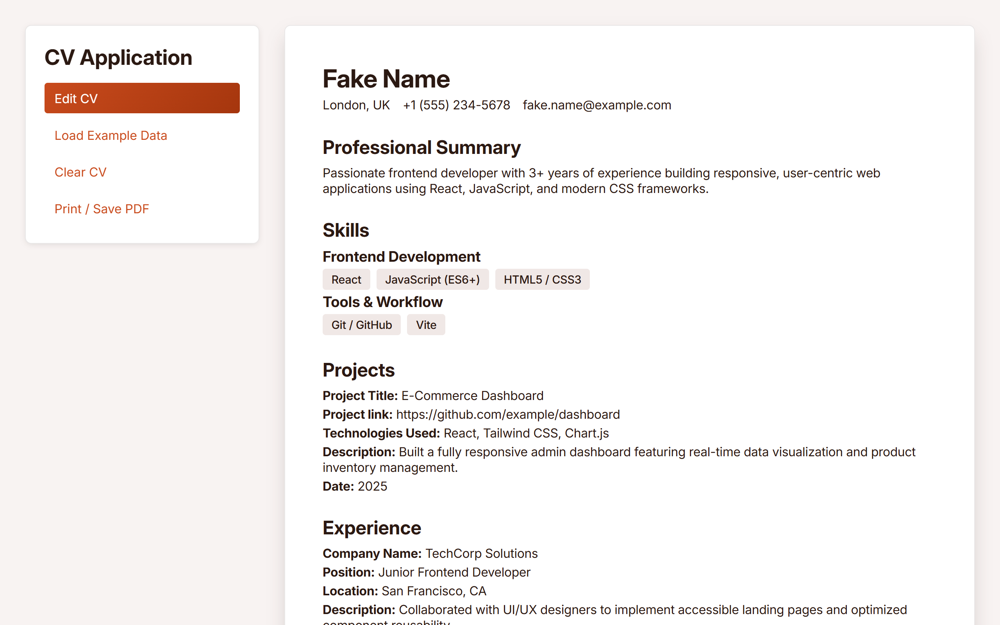

# React CV Application 📝

A dynamic, fully responsive CV (Curriculum Vitae) builder built with **React**. This project was created to master state management, component composition, and data flow in React.

[View Live Demo](https://cv-application-ten-psi.vercel.app/)



## ✨ Features

- **Interactive Forms & Preview Mode:** Toggle seamlessly between edit mode and a clean, professional preview mode.
- **Persistent Storage:** Uses `localStorage` so your data and layout preferences stay saved even if you refresh the page.
- **Dynamic Sections:** Easily add, edit, or delete multiple entries for Work Experience, Education, Projects, and Skills.
- **Section Visibility Toggles:** Use the sidebar controls to show or hide specific sections of your CV on the fly.
- **Example Data Loader:** Instantly populate the CV with sample data to test out layouts.
- **PDF Export:** Built-in print functionality (`window.print()`) allowing users to easily save their CV as a PDF.
- **Clear & Reset:** A quick-reset button to wipe storage and start fresh.

## 🛠️ Built With

- **React** (Hooks: `useState`, `useEffect`)
- **JavaScript (ES6+)**
- **HTML5 & CSS3**
- **Vite**

## 🚀 Getting Started

To run this project locally, follow these steps:

1. **Clone the repository:**

    ```bash
    git clone [https://github.com/cmatsagka/cv-application](https://github.com/cmatsagka/cv-application)
    ```

2. **Navigate into the project directory:**

    ```bash
    cd cv-application
    ```

3. **Install dependencies:**

    ```bash
    npm install
    ```

4. **Run the development server:**

    ```bash
    npm run dev
    ```

5. **Open your browser and visit http://localhost:5173 (or the port provided in your terminal).**
